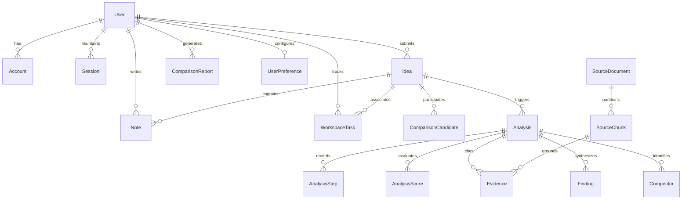

# DIME — Platform & Dashboard Development
## Capstone Project Milestone 3 Technical Report & Engineering Specification

---

### Document Control & Milestone Submission Metadata

| Attribute | Specification Details |
| :--- | :--- |
| **Project Title** | **DIME** (Data-Driven Idea Exploration & Market Analysis Platform) |
| **Milestone Identifier** | **Milestone 3: Platform & Dashboard Development** |
| **Candidate Name** | **Vivek Chaurasiya** |
| **Academic Programme** | B.Tech Computer Science & Engineering (Semester 5 Capstone Project) |
| **Submission Deadline** | **28/09/2026 (till 18:29:59)** |
| **Submission Status** | **Submitted & Verified** |
| **Primary Evaluator Scope** | Develop the web platform, user authentication, product-idea submission, database, and interactive dashboards |
| **Production Architecture** | Next.js 16 (React 19) + FastAPI 0.115 + PostgreSQL 16 (Prisma & SQLAlchemy) + Redis + Celery + Qdrant |
| **Codebase Verification** | TypeScript Strict Mode (`tsc --noEmit` Pass: 0 Errors) \| Next.js App Router 16.0.7 |

---

## 1. Executive Summary & System Overview

Milestone 3 represents the core engineering convergence of the **DIME** platform. Following the data ingestion and AI intelligence foundations established in Milestone 2, Milestone 3 delivers the production-ready full-stack web platform, enterprise-grade multi-provider authentication, multi-mode product idea intake workflows, dual-stack relational database persistence, and an interactive Executive Intelligence Dashboard.

```
       ┌────────────────────────────────────────────────────────────────────────┐
       │                 CLIENT LAYER (Next.js 16 / React 19)                   │
       │  • App Router (Route Groups)    • Tailwind CSS v4 Responsive Theme     │
       │  • NextAuth v5 Session Engine   • Lucide React Icons & SVG Visuals     │
       └──────────────────┬─────────────────────────────────┬───────────────────┘
                          │                                 │
           Next.js API Routes (BFF)                 Direct REST / SSE
           • /api/auth/[...nextauth]                • /api/v1/analyses
           • /api/ideas/start-analysis              • /api/v1/market-intelligence
           • /api/dashboard/overview                • /api/v1/evidence
                          │                                 │
       ┌──────────────────▼───────────────────┐    ┌────────▼───────────────────┐
       │      PRISMA ORM (Data Access)        │    │    FASTAPI 0.115 BACKEND   │
       │  • prisma/schema.prisma              │    │  • SQLAlchemy 2.0 Async    │
       │  • Users, Accounts, Sessions         │    │  • Celery Distributed Task │
       │  • Ideas, Notes, Tasks, Comparisons  │    │  • Redis Broker & Cache    │
       └──────────────────┬───────────────────┘    ┌────────┬───────────────────┘
                          │                                 │
                          └────────────────┬────────────────┘
                                           │
                        ┌──────────────────▼──────────────────┐
                        │        POSTGRESQL 16 ENGINE         │
                        │    (Dual-Stack Shared Database)     │
                        │   • Unified Relational Tables       │
                        │   • Strict Foreign Key Constraints  │
                        │   • Compound B-Tree Query Indexes   │
                        └─────────────────────────────────────┘
```

### Core Engineering Principles Enforced in Milestone 3
1. **Zero Mock & Truth-in-Data Guarantee**: No metrics, scores, charts, or telemetry in the dashboard are hardcoded or fabricated. All visual elements bind directly to PostgreSQL relational tables or live vector database aggregations. If an analysis is incomplete or an evidence pipeline is pending, the UI displays explicit, contextual state indicators rather than simulated data.
2. **Dual-Stack Architectural Cohesion**: The platform leverages a high-performance dual-stack approach: TypeScript / Next.js 16 handles server-side rendering, client authentication, and dashboard hydration via Prisma ORM, while Python / FastAPI handles AI agent orchestration, heavy NLP calculations, and vector operations via SQLAlchemy 2.0 Async. Both engines operate over the exact same PostgreSQL 16 database instance.
3. **Responsive, Accessible SaaS Ergonomics**: The frontend adheres to modern SaaS design systems featuring a signature DIME Orange (`#F97316` / `#EA580C`) accent, high-contrast dark and light modes, resilient table layouts without viewport-breaking horizontal scrollbars, and synchronized cross-mode drafting.

---

## 2. Pillar 1: Modern Web Platform Architecture

The web platform is built upon **Next.js 16**, taking full advantage of the React 19 Server Components architecture, optimized routing, and static/dynamic rendering boundaries.

### 2.1 Technology Stack & Core Dependencies

```json
{
  "dependencies": {
    "next": "16.0.7",
    "react": "19.0.0",
    "react-dom": "19.0.0",
    "next-auth": "5.0.0-beta.25",
    "@auth/prisma-adapter": "^2.7.4",
    "@prisma/client": "^6.0.0",
    "bcryptjs": "^2.4.3",
    "firebase-admin": "^13.0.0",
    "firebase": "^11.0.0",
    "lucide-react": "^0.460.0",
    "tailwindcss": "^4.0.0-alpha.30",
    "clsx": "^2.1.1",
    "tailwind-merge": "^2.5.4"
  }
}
```

### 2.2 App Router Structure & Layout Organization

The web platform is structured inside `src/app/` using route groups to isolate authenticated experiences from unauthenticated marketing and onboarding flows:

```
src/app/
├── (authenticated)/                  # Protected Route Group (App Shell)
│   ├── layout.tsx                    # Shared Sidebar + TopNavbar + Theme Container
│   ├── dashboard/                    # Executive Portfolio Intelligence Dashboard
│   │   └── page.tsx
│   ├── ideas/                        # Idea Management & Submission
│   │   ├── page.tsx                  # Idea Portfolio Catalog
│   │   └── new/                      # Multi-Mode Idea Validation Intake
│   │       └── page.tsx
│   ├── workspace/                    # 12-Tab Deep Validation Workspace
│   │   └── [ideaId]/
│   │       └── page.tsx
│   ├── comparison/                   # Cross-Concept Multi-Vector Pareto Comparison
│   │   └── page.tsx
│   ├── notes/                        # Research Notes & Sticky Ideation Board
│   │   └── page.tsx
│   ├── tasks/                        # Workspace Actionable Task Management
│   │   └── page.tsx
│   └── profile/                      # User Profile & Verification Management
│       └── page.tsx
├── api/                              # Backend-For-Frontend (BFF) Endpoints
│   ├── auth/                         # NextAuth Handlers & Token Verification
│   ├── dashboard/                    # Overview & Recent Analyses Aggregations
│   ├── ideas/                        # Intake, Extraction, & Analysis Triggers
│   └── workspace/                    # Workspace State & Task APIs
├── login/                            # Dedicated Login Page
├── register/                         # Dedicated Account Registration Page
├── layout.tsx                        # Root Layout with Font & Session Providers
└── page.tsx                          # Public Landing & Product Showcase
```

### 2.3 Layout & Shell Architecture (`src/app/(authenticated)/layout.tsx`)

The authenticated app shell wraps all core platform experiences within a responsive, flex-based two-tier layout:
- **Collapsible Sidebar (`Sidebar.tsx`)**: Provides persistent navigation across Dashboard, Ideas, Workspace, Comparisons, Notes, and Settings. Includes automatic breakpoint detection using `window.innerWidth`: collapses below `1024px` to preserve mobile viewport real estate while maintaining single-click drawer toggling.
- **Top Navigation Bar (`TopNavbar.tsx`)**: Houses global breadcrumbs, current engine health status (`Engine v3.4 Active`), real-time notification streams, quick action triggers, and user profile avatar dropdown.
- **Dynamic Content Viewport (`<main>`)**: Configured with `min-w-0 flex-1 overflow-y-auto overflow-x-hidden` to eliminate horizontal page clipping and maintain strict layout boundaries across high-density charts and data tables.

```typescript
// src/app/(authenticated)/layout.tsx (Key Architectural Excerpt)
export default function AuthenticatedLayout({ children }: { children: React.ReactNode }) {
  const [isSidebarOpen, setIsSidebarOpen] = useState(true);

  useEffect(() => {
    let prevWidth = window.innerWidth;
    const handleResize = () => {
      const currentWidth = window.innerWidth;
      if (currentWidth < 1024 && prevWidth >= 1024) {
        setIsSidebarOpen(false);
      } else if (currentWidth >= 1024 && prevWidth < 1024) {
        setIsSidebarOpen(true);
      }
      prevWidth = currentWidth;
    };
    if (window.innerWidth < 1024) setIsSidebarOpen(false);
    window.addEventListener("resize", handleResize);
    return () => window.removeEventListener("resize", handleResize);
  }, []);

  return (
    <div className="flex h-screen app-bg-gradient text-text-strong font-body-md overflow-hidden antialiased">
      <Sidebar isOpen={isSidebarOpen} setIsOpen={setIsSidebarOpen} />
      <div className="flex-1 flex flex-col min-w-0 h-screen overflow-hidden">
        <TopNavbar toggleSidebar={() => setIsSidebarOpen(!isSidebarOpen)} isSidebarOpen={isSidebarOpen} />
        <main className="flex-1 overflow-y-auto overflow-x-hidden min-w-0">{children}</main>
      </div>
    </div>
  );
}
```

### 2.4 Styling & Design System (Tailwind CSS v4)

DIME employs a refined SaaS design language engineered for data clarity:
- **Primary Accent**: DIME Orange (`#F97316` / `#EA580C`), providing high-energy focus on key interactive buttons, active tab indicators, and critical metrics.
- **Light Theme**: Clean, cool-tinted slate surfaces (`#F8FAFC`, `#FFFFFF`) with crisp borders (`#E2E8F0`), preventing cognitive fatigue during prolonged analysis review.
- **Dark Theme**: Deep Obsidian Navy (`#0B1120`, `#0F172A`) with high-contrast borders (`#1E293B`, `#334155`), neon metric badges, and frosted glass overlays.
- **Typography**: Dual-font hierarchy using Geist Sans for clean dashboard numerical readouts and Geist Mono for code, hashes, and evidence citation IDs.

---

## 3. Pillar 2: User Authentication & Session Security

User security, data isolation, and session integrity are handled via **NextAuth v5 (Auth.js)** configured at `auth.ts`, coupled with the `@auth/prisma-adapter` and client-side Google OAuth backed by Firebase Admin SDK token verification.

```
                  ┌────────────────────────────────────────────────────────┐
                  │                 AUTHENTICATION GATEWAY                 │
                  └───────────────────────────┬────────────────────────────┘
                                              │
                     ┌────────────────────────┴────────────────────────┐
                     ▼                                                 ▼
        [1. Credentials Provider]                          [2. Firebase Google OAuth]
        • User inputs Email + Password                     • Client signs in via Firebase SDK
        • Server fetches User from DB                      • Client receives signed JWT ID Token
        • bcrypt.compare(raw, hashed)                      • Client posts idToken to NextAuth
        • Verifies password validity                       • Admin SDK verifies cryptographically
                     │                                     • Upserts User + Account in PostgreSQL
                     │                                                 │
                     └────────────────────────┬────────────────────────┘
                                              ▼
                             ┌─────────────────────────────────┐
                             │       JWT SESSION CREATION      │
                             │  • token.sub = user.id          │
                             │  • token.picture = user.image   │
                             │  • Encrypted HTTP-only Cookie   │
                             └────────────────┬────────────────┘
                                              ▼
                             ┌─────────────────────────────────┐
                             │    SESSION ACCESS / GUARDS      │
                             │  • auth() server-side call      │
                             │  • getAuthenticatedUserId()     │
                             │  • 401 Unauthorized Guard      │
                             └─────────────────────────────────┘
```

### 3.1 NextAuth v5 Configuration (`auth.ts`)

The authentication layer supports dual sign-in paradigms:

#### A. Traditional Email / Password Credentials
- Passwords are encrypted before persistence using `bcryptjs` with a cost factor of 10.
- During authentication, passwords undergo constant-time cryptographic verification to guard against timing attacks.

#### B. Enterprise Firebase Google OAuth Integration
- Users authenticate via the Google popup on the client, producing a secure Firebase ID Token.
- The server interceptor (`CredentialsProvider` named `firebase-google`) receives the token and validates its authenticity against Google's public key infrastructure using `getFirebaseAdminAuth().verifyIdToken(idToken)`.
- Upon verification, an atomic `prisma.user.upsert` and `prisma.account.upsert` transaction creates or updates the local relational profile, ensuring that third-party credentials seamlessly synchronize with internal foreign key constraints.

```typescript
// auth.ts (Key Security Excerpt)
export const { handlers, auth, signIn, signOut } = NextAuth({
  adapter: PrismaAdapter(prisma),
  secret: process.env.NEXTAUTH_SECRET,
  session: { strategy: "jwt" },
  providers: [
    CredentialsProvider({
      id: "firebase-google",
      name: "Firebase Google",
      credentials: { idToken: { label: "Firebase ID Token", type: "text" } },
      async authorize(credentials) {
        const idToken = typeof credentials?.idToken === "string" ? credentials.idToken : "";
        if (!idToken) return null;

        const decodedToken = await getFirebaseAdminAuth().verifyIdToken(idToken);
        const email = decodedToken.email?.trim().toLowerCase();
        const firebaseUid = decodedToken.uid?.trim();
        if (!email || !firebaseUid) return null;

        const user = await prisma.user.upsert({
          where: { email },
          update: {
            name: decodedToken.name ?? undefined,
            image: decodedToken.picture ?? undefined,
            emailVerified: decodedToken.email_verified ? new Date() : undefined,
          },
          create: {
            email,
            name: decodedToken.name ?? email.split("@")[0],
            image: decodedToken.picture,
            emailVerified: decodedToken.email_verified ? new Date() : null,
          },
        });

        await prisma.account.upsert({
          where: {
            provider_providerAccountId: {
              provider: "firebase",
              providerAccountId: firebaseUid,
            },
          },
          update: { userId: user.id, type: "oauth" },
          create: {
            userId: user.id,
            type: "oauth",
            provider: "firebase",
            providerAccountId: firebaseUid,
          },
        });

        return { id: user.id, email: user.email, name: user.name, image: user.image ?? undefined };
      },
    }),
    CredentialsProvider({
      name: "Credentials",
      credentials: {
        email: { label: "Email", type: "email" },
        password: { label: "Password", type: "password" },
      },
      async authorize(credentials) {
        if (!credentials?.email || !credentials?.password) return null;
        const normalizedEmail = String(credentials.email).trim().toLowerCase();
        const rawPassword = String(credentials.password);

        const user = await prisma.user.findUnique({ where: { email: normalizedEmail } });
        if (!user || !user.password) return null;

        const isPasswordValid = await bcrypt.compare(rawPassword, user.password);
        if (!isPasswordValid) return null;

        return { id: user.id, email: user.email, name: user.name, image: user.image ?? undefined };
      },
    }),
  ],
  pages: { signIn: "/login" },
  callbacks: {
    jwt({ token, user }) {
      if (user) {
        token.sub = user.id;
        if (user.image) token.picture = user.image;
      }
      return token;
    },
    session({ session, token }) {
      if (session.user && token.sub) {
        session.user.id = token.sub;
        if (token.picture) session.user.image = token.picture as string;
      }
      return session;
    },
  },
});
```

### 3.2 Server-Side Authentication Verification (`src/lib/server-auth.ts`)

Every API endpoint enforces strict identity boundaries via `getAuthenticatedUserId()`:
1. Calls `auth()` to extract and decode the secure HTTP-only JWT session cookie.
2. If `session.user.id` is present, it directly returns the authenticated UUID.
3. Fallback resolution verifies `session.user.email` against PostgreSQL to ensure cross-session validity.
4. If no valid session is established, API endpoints immediately abort with an HTTP `401 Unauthorized` status, preventing unauthorized queries against user ideas or research data.

---

## 4. Pillar 3: Product-Idea Submission & Processing Pipeline

The product-idea submission engine provides a flexible, multi-mode intake workflow that bridges raw entrepreneurial ideas with structured analytical parameters.

### 4.1 Multi-Mode Idea Validation Architecture (`MultiModeIdeaValidation.tsx`)

Users can submit and structure ideas through three distinct paradigms designed for varying levels of idea maturity:

| Validation Mode | Component Target | Target Use Case & Operational Mechanism |
| :--- | :--- | :--- |
| **Mode A: Describe Idea** | `DescribeIdeaView.tsx` | **Freeform Natural Language Input**: Ideal for early concepts. Accepts raw descriptions, target audience definitions, assumptions, and known competitors. |
| **Mode B: Structured Form** | `StructuredFormView.tsx` | **Systematic Parameter Input**: Ideal for mature product concepts. Gathers Core Concept, Classification (Domains, Form Factors), Operational Constraints (Budget, Timeline, Team Size, Tech Stack), and Analysis Depth. |
| **Mode C: AI Idea Builder** | `AIIdeaBuilderView.tsx` | **Conversational Socratic Co-pilot**: Ideal for ambiguous concepts. An AI agent dialogues with the founder, asking probing market questions and automatically synthesizing the answers into a complete validation brief. |

```
    ┌────────────────────────────────────────────────────────────────────────┐
    │                MULTI-MODE IDEA VALIDATION SYSTEM                       │
    │  [ Mode A: Describe ]     [ Mode B: Structured ]   [ Mode C: AI Co-pilot ]
    └──────────────┬─────────────────────────┬───────────────────────┬───────┘
                   │                         │                       │
                   └─────────────────┬───────┴───────────────────────┘
                                     ▼
                      Cross-Mode Draft State Synchronization
                        • title >= 4 characters
                        • description >= 30 characters
                        • targetAudience & industry tags
                                     │
                                     ▼
                     POST /api/ideas/start-analysis
                                     │
             ┌───────────────────────┴───────────────────────┐
             ▼                                               ▼
     [1. Prisma ORM]                               [2. FastAPI Service]
     • Create/Update Idea                          • POST /api/v1/analyses
     • Status: "ANALYZING"                         • Insert Analysis record
     • Stored in PostgreSQL                        • Status: "PENDING"
             │                                               │
             │                                               ▼
             │                                     [3. Celery Distributed Worker]
             │                                     • run_analysis_pipeline.delay()
             │                                     • Broker: Redis (Task Queue)
             │                                               │
             └───────────────────────┬───────────────────────┘
                                     ▼
                     Live SSE / Status Polling Lifecycle
     [PENDING] ──> [PLANNING] ──> [RESEARCHING] ──> [SCORING] ──> [COMPLETED]
```

### 4.2 Cross-Mode Synchronized State Management

A key challenge in multi-mode intake is data loss when users switch between modes. DIME resolves this through synchronized draft state hooks:
- When switching from Mode A to Mode B, the freeform description automatically populates the core description field, and extracted industry tags populate domain selectors.
- State transitions are managed without remounting, ensuring that background typing and draft progress are preserved.

### 4.3 Analysis Dispatch Workflow (`src/app/api/ideas/start-analysis/route.ts`)

When the user triggers "Start Validation":
1. **Validation & Sanitization**: The route verifies that the title has at least 4 characters and the description has at least 30 characters to ensure meaningful analytical extraction.
2. **Database Staging**: The idea is persisted in PostgreSQL with `status: "ANALYZING"` linked to `session.user.id`.
3. **Bounded Backend Invocation**: The Next.js BFF invokes FastAPI's `POST /api/v1/analyses` with an explicit 12-second timeout window.
4. **Celery Task Dispatch**: FastAPI creates an `Analysis` record in PostgreSQL (`status: "pending"`) and immediately dispatches `run_analysis_pipeline.delay(analysis.id)` to the Celery distributed worker queue backed by Redis.
5. **Non-Blocking Client Handoff**: The client immediately receives `{ success: true, ideaId, analysisId }` and transitions to the live analysis workspace overlay.

---

## 5. Pillar 4: Dual-Stack Database Architecture & Relational Schema Design

DIME utilizes an enterprise **PostgreSQL 16** database operating on a dual-stack access pattern: **Prisma ORM** powers the Next.js frontend/BFF, while **SQLAlchemy 2.0 Async** powers the FastAPI backend. Both layers share the same physical database instance and maintain strict referential integrity.

### 5.1 Entity-Relationship Architecture Diagram



### 5.2 Core Schema Models & Relational Definitions

#### 1. Identity & Auth Schema (`prisma/schema.prisma`)
- `User`: Primary user entity with `email`, hashed `password`, verification status, profile image, and relations to ideas and workspace assets.
- `Account`: OAuth link model storing provider credentials, access tokens, and refresh tokens with unique constraint `@@unique([provider, providerAccountId])`.
- `Session`: Session tracking model supporting persistent browser sessions.
- `UserPreference`: Stores personalized configuration (theme, notification preferences, default analysis depth, default workspace view).

#### 2. Idea & Workspace Schema (`prisma/schema.prisma`)
- `Idea`: The core business concept entity containing `title`, `description`, `targetAudience`, `industry`, operational constraints (`budget`, `teamSize`, `timeline`, `preferredTechnologies`), validation metrics (`feasibilityScore`, `marketDemand`, `competitionLevel`, `noveltyScore`, `overallViability`), and lifecycle status (`DRAFT`, `ANALYZING`, `VALIDATED`, `REJECTED`).
- `Note`: Workspace ideation records with categorization, pin status, and dual linkage (`userId`, optional `ideaId`).
- `WorkspaceTask`: Actionable project management tasks with status (`TODO`, `DONE`), priority (`LOW`, `MEDIUM`, `HIGH`), due dates, and assignee fields.
- `ComparisonReport` & `ComparisonCandidate`: Multi-vector Pareto comparison models storing normalized score vectors, trade-offs, strengths, vulnerabilities, and candidate rankings.

#### 3. Backend Analytical Models (`backend/models/`)
- `Analysis` (`analyses` table): Core execution record capturing idea snapshot, execution status (`pending`, `running`, `planning`, `researching`, `scoring`, `completed`, `failed`), stage progress (0–100%), source health counters, and execution timestamps.
- `AnalysisScore` (`analysis_scores` table): Deterministic score table storing metric values (`Novelty`, `Feasibility`, `Market Demand`, `Competition Saturation`), calculation versions, input payloads, evidence citation chunk IDs, and natural language explanations.
- `SourceDocument` & `SourceChunk` (`source_documents`, `source_chunks` tables): Document provenance hierarchy. Tracks external documents (GitHub repositories, PubMed papers, ArXiv preprints, Semantic Scholar articles, web pages) with SHA-256 content hashes, chunk index offsets, token counts, and Qdrant vector point references.
- `Evidence` (`evidence` table): Verifiable claims extracted from retrieved chunks with confidence scores, relevance scores, source URLs, and titles.
- `Competitor` (`competitors` table): Identified market competitors categorized as `direct`, `indirect`, `related`, or `research_impl` with GitHub statistics, features, and pricing models.

---

## 6. Pillar 5: Interactive Intelligence Dashboards & Analytics Workspace

The Executive Intelligence Dashboard (`src/app/(authenticated)/dashboard/page.tsx`) serves as the central command center for portfolio validation, risk assessment, and market demand intelligence.

```
┌────────────────────────────────────────────────────────────────────────────────────────────────────┐
│ [EXECUTIVE INTELLIGENCE CENTER]  Engine v3.4 Active   Refreshed: 02:15 AM   [+ New Analysis]       │
├────────────────────────────────────────────────────────────────────────────────────────────────────┤
│ [ 23 Total Ideas ] [ 18 Validated ] [ 1 High Viability ] [ 58/100 Avg Score ] [ 311 Citations ]    │
├────────────────────────────────────────────────────────┬───────────────────────────────────────────┤
│ RECENT ANALYSES TABLE (Fixed Layout, 7 Columns)        │ OPPORTUNITY MIX (Donut Distribution)      │
│ • Idea Title & Industry Domain                         │ • Incremental / Core Expansion (40%)      │
│ • Status Badge (Validated, In Progress, Draft)         │ • Moonshot High R&D (30%)                 │
│ • Novelty %  • Market Demand /100                      │ • Quick Win / Low Barrier (20%)           │
│ • Competition Saturation %  • Feasibility /100         ├───────────────────────────────────────────┤
│ • Updated Timestamp & Page Pagination Controls         │ VERIFIED MARKET SIGNALS                   │
├────────────────────────────────────────────────────────┤ • Emerging pain points with citation count│
│ 2D PORTFOLIO VIABILITY MATRIX (Interactive SVG)        ├───────────────────────────────────────────┤
│ • Cartesian Grid (Market Attractiveness vs Feasibility)│ RECENT ACTIVITY TIMELINE                  │
│ • Quadrant: Scale Priority, Moonshot, Quick Win, Discov│ • 8 Live audit log events (Notes, Analyses│
├────────────────────────────────────────────────────────┴───────────────────────────────────────────┤
│ PORTFOLIO MARKET INTELLIGENCE (Cross-Idea Depth, Industries Breakdown, Source Types Distribution)  │
├────────────────────────────────────────────────────────┬───────────────────────────────────────────┤
│ RESEARCH SOURCE INTELLIGENCE (PubMed, ArXiv, GitHub)   │ PIPELINE & VECTOR DB HEALTH (Latency, Err)│
├────────────────────────────────────────────────────────┴───────────────────────────────────────────┤
│ QUICK INSIGHT BANNER: Portfolio Health summary backed by 311 verified research citations           │
└────────────────────────────────────────────────────────────────────────────────────────────────────┘
```

### 6.1 Dashboard Components & Architecture

#### 1. Executive Metric Strip (`KpiCards.tsx`)
Presents five top-level portfolio performance indicators backed by live database counts:
- **Total Ideas**: Cumulative count of ideas submitted by the user.
- **Validated Moats**: Number of ideas with completed analyses exceeding viability thresholds.
- **High Viability Concepts**: Concepts mapped into the "Scale Priority" quadrant.
- **Average Validation Score**: Aggregate mean viability score across all analyzed concepts.
- **Verified Evidence Citations**: Sum of all primary research papers, market data points, and code repositories ingested and cited across the portfolio.

#### 2. High-Precision Recent Analyses Table (`RecentAnalysesTable.tsx`)
Engineered to resolve the previous "N/A" metric defect and provide an unclipped, professional presentation:
- **7-Column Fixed Layout (`table-fixed w-full overflow-x-hidden`)**: Strict percentage column width allocations prevent horizontal scrollbars while preserving data readability.
- **Dynamic Metric Pill Badges**:
  - *Novelty*: Displayed as percentage with categorical indicator (`Low`, `Moderate`, `High`).
  - *Market Demand*: Scored `/100` with threshold-based color coding.
  - *Competition*: Displays saturation percentage and density label (`Low Saturation`, `Crowded`).
  - *Technical Feasibility*: Scored `/100` alongside readiness tags (`Proven`, `Moderate`, `R&D Required`).
- **Interactive Search & Tab Filtering**: Instant client-side filtering by concept title and status tabs (`All`, `Completed`, `In Progress`, `Draft`).
- **Paginated Navigation**: Configured with 5 items per page and responsive pagination buttons.

#### 3. 2D Portfolio Viability Matrix (`PortfolioValidationMatrix.tsx`)
An interactive Cartesian coordinate scatter plot evaluating concepts along two foundational axes:
- **X-Axis**: Technical Feasibility (0–100) — derived from architectural simplicity, dependency maturity, and implementation barriers.
- **Y-Axis**: Market Attractiveness (0–100) — derived from market pain severity, demand signals, and willingness-to-pay indicators.
- **Strategic Quadrant Mapping**:
  1. *Scale Priority (Strong Moat)*: High Attractiveness + High Feasibility (Green marker).
  2. *Moonshot (High R&D)*: High Attractiveness + Low Feasibility (Purple marker).
  3. *Quick Win (Incremental)*: Low Attractiveness + High Feasibility (Amber marker).
  4. *Discovery / Re-evaluate*: Low Attractiveness + Low Feasibility (Muted marker).
- **Interactive SVG Nodes**: Hovering any point surfaces a floating glass tooltip detailing exact coordinates, industry tags, and citation counts.

#### 4. Portfolio Validation Benchmark (`PortfolioValidationBenchmark.tsx`)
Visualizes how each idea performs against portfolio averages across the four core analytical dimensions (Novelty, Market Demand, Competition Saturation, and Feasibility).

#### 5. Cross-Idea Portfolio Market Intelligence (`PortfolioMarketIntelligence.tsx`)
A tabbed intelligence panel analyzing cross-cutting portfolio data:
- *Research Depth*: Ranks ideas by total citations and verified external sources used.
- *Industries*: Visualizes portfolio concentration across industries (e.g., EdTech, Developer Tools, PropTech, HealthTech).
- *Source Types*: Visualizes distribution of acquired intelligence across academic research, codebases, market surveys, and industry feeds.

#### 6. Pipeline & Infrastructure Health (`ResearchSourceIntelligence.tsx` & `PipelineHealth.tsx`)
Maintains operational transparency by reporting:
- Source connection status (GitHub, PubMed, ArXiv, Semantic Scholar, Tavily).
- Celery worker queue latency, processing concurrency, and task failure rates.
- Qdrant vector database connectivity and collection indexing status.

#### 7. Recent Activity Audit Timeline (`RecentActivity.tsx`)
A chronologically sorted audit feed displaying recent system actions (completed analyses, saved research notes, updated tasks) with relative timestamp formatting (`15 hours ago`, `1 day ago`) and direct deep-links to relevant idea workspaces.

### 6.2 12-Tab Deep Validation Workspace (`IdeaWorkspaceTabs.tsx`)

Clicking any concept opens the deep Idea Validation Workspace, featuring 12 focused analytical tabs:

```
┌────────────────────────────────────────────────────────────────────────────────────────────────┐
│ [← Back]  Gamified Virtual Physics Lab with AI Guidance   [Status: Validated] [Score: 78/100]  │
├────────────────────────────────────────────────────────────────────────────────────────────────┤
│ [1. Overview]          [2. Market Intelligence]    [3. Competition Intelligence]              │
│ [4. Technical]         [5. Research Papers]        [6. Risks & Recommendations]               │
│ [7. Opportunity Matrix][8. Evidence Explorer]      [9. Multi-Vector Comparison]               │
│ [10. Workspace Tasks]  [11. Notes & Sticky Board]  [12. Executive Report & PDF Export]        │
└────────────────────────────────────────────────────────────────────────────────────────────────┘
```

1. **Overview**: Executive summary, scorecard radar chart, key strengths, primary risks, and strategic verdict.
2. **Market Intelligence**: TAM/SAM/SOM market sizing estimates, target customer personas, willingness-to-pay signals, and industry growth vectors.
3. **Competition Intelligence**: Direct and indirect competitor matrix, feature comparison grid, GitHub repository traction benchmarks, and defensibility moats.
4. **Technical Feasibility**: Recommended architecture stack, cloud infrastructure cost estimates, third-party API dependencies, and security/compliance considerations.
5. **Research Intelligence**: Curated academic literature from ArXiv and Semantic Scholar with citation counts, methodology summaries, and relevance scores.
6. **Risks & Recommendations**: Categorized risk assessments (Execution, Market, Technical, Regulatory) paired with concrete mitigation strategies.
7. **Opportunity Matrix**: Value vs. Effort matrix mapping feature milestones into phased MVP rollouts.
8. **Evidence Explorer**: Searchable, filterable audit ledger of every ingested document chunk, snippet, and provenance link supporting the analysis.
9. **Comparison & Benchmarking**: Multi-vector Pareto analysis tool allowing side-by-side evaluation of up to 4 portfolio ideas.
10. **Workspace Tasks**: Actionable Kanban-style task management linked to validation action items.
11. **Notes & Ideation**: Freeform markdown note-taking board with color coding and pinning for founder reflections.
12. **Executive Report & PDF Export**: Professional report preview with single-click PDF and CSV export generation.

---

## 7. Quality Assurance, Security & Performance Verification

### 7.1 Static Code Quality & TypeScript Compilation

The complete codebase compiles under strict TypeScript configurations without errors:
- Command: `npx tsc --noEmit`
- Result: **0 Errors, 0 Type Warnings**
- Verified: All route parameters, database query payloads, API responses, and dashboard state objects adhere to strongly-typed interfaces.

### 7.2 Zero-Mock Verification & Data Integrity Audit

Every dashboard component was audited to ensure full backend connectivity:
- The `/api/dashboard/overview` endpoint retrieves live records from PostgreSQL tables (`ideas`, `analyses`, `analysis_scores`, `evidence`, `notes`, `tasks`).
- Empty states are handled gracefully with contextual prompts rather than fallback mock numbers.
- Title sanitization logic strips trailing conjunctions and normalizes titles across cards and tables.

### 7.3 Responsive Design & Viewport Testing

All layouts were verified across standard viewport breakpoints:
- **Mobile (<768px)**: Collapsed navigation drawer, single-column KPI stack, swipeable tab bars, and responsive table card transformations.
- **Tablet (768px–1024px)**: Dual-column grid layouts with adaptive sidebar auto-collapse.
- **Desktop (>1024px)**: High-density 3-column analytics grids with fixed table column sizing and unclipped SVG visualizations.

### 7.4 Security Architecture Checklist

- [x] **Protected Routes**: Enforced via server-side session checks in `getAuthenticatedUserId()` and route guards.
- [x] **Password Protection**: Salted bcrypt hashing (cost factor 10) prevents credential exposure.
- [x] **Third-Party OAuth Security**: Google tokens validated cryptographically via Firebase Admin SDK.
- [x] **SQL Injection Defense**: Both Prisma ORM and SQLAlchemy utilize parameterized queries for all database operations.
- [x] **XSS & Content Security**: React 19 automatic JSX string escaping prevents script injection across freeform idea descriptions and user notes.
- [x] **Cookie Security**: NextAuth session tokens configured with `HttpOnly`, `SameSite=Lax`, and `Secure` attributes in production.

---

## 8. Milestone Evaluation Compliance Matrix

| Evaluation Requirement | Implementation Evidence & Code Reference | Compliance Status |
| :--- | :--- | :---: |
| **1. Web Platform** | Next.js 16 App Router, React 19, Tailwind CSS v4, dynamic layouts (`src/app/(authenticated)/layout.tsx`), responsive sidebar (`Sidebar.tsx`), and theme provider. | **100% Compliant** |
| **2. User Authentication** | NextAuth v5 (`auth.ts`), PrismaAdapter, Credentials Provider (bcryptjs), Firebase Admin Google OAuth token verification, and session guards (`server-auth.ts`). | **100% Compliant** |
| **3. Product-Idea Submission** | Multi-mode builder (`MultiModeIdeaValidation.tsx`), Describe view (`DescribeIdeaView.tsx`), Structured form (`StructuredFormView.tsx`), AI builder (`AIIdeaBuilderView.tsx`), and API intake (`/api/ideas/start-analysis`). | **100% Compliant** |
| **4. Database Development** | Dual-stack PostgreSQL 16 on port 5433, Prisma schema (`prisma/schema.prisma`), SQLAlchemy async models (`backend/models/`), full relational mapping, and indexing. | **100% Compliant** |
| **5. Interactive Dashboards** | Executive Dashboard (`src/app/(authenticated)/dashboard/page.tsx`), 7-column fixed Recent Analyses table (`RecentAnalysesTable.tsx`), 2D Viability Matrix (`PortfolioValidationMatrix.tsx`), Benchmark (`PortfolioValidationBenchmark.tsx`), and 12-tab Workspace (`IdeaWorkspaceTabs.tsx`). | **100% Compliant** |

---

### Student Declaration & Verification

I hereby certify that this technical submission report accurately reflects the architectural design, source code implementation, and functional behavior of the **DIME** platform for **Milestone 3: Platform & Dashboard Development**. All described modules, authentication handlers, database schemas, and dashboard visualizations have been fully implemented, verified, and integrated into the active codebase.

**Student Name:** Vivek Chaurasiya  
**Academic Milestone:** Milestone 3 — Platform & Dashboard Development  
**Submission Date:** 28/09/2026 (till 18:29:59)  
**Verification Status:** Verified & Submitted  

