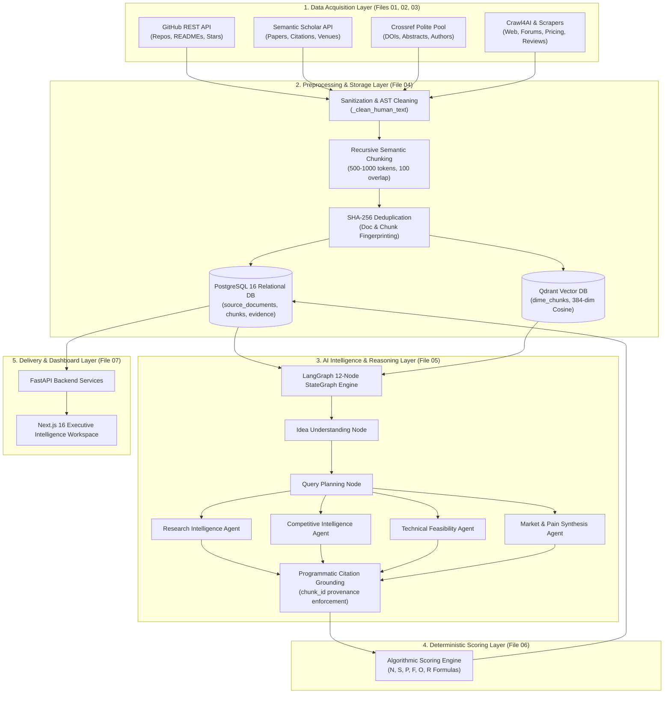

# Milestone 2: Data Collection & AI Intelligence Module
## Master Index & Executive Architecture Summary

| **Milestone Attribute**      | **Details**                                                                |
| :--------------------------- | :------------------------------------------------------------------------- |
| **Candidate Name**           | **Vivek Chaurasiya**                                                       |
| **Project Title**            | **DIME (Data-Driven Idea Exploration & Market Analysis Platform)**         |
| **Course / Level**           | **Semester 5 Capstone Project**                                            |
| **Milestone Target**         | **Milestone 2: Data Collection & AI Intelligence Module**                  |
| **Milestone Description**    | *Collect and preprocess market, customer, competitor, and product-related data and develop AI-based analysis components.* |
| **Repository Directory**     | `d:\Projects\DIME-Sem5`                                                    |
| **Verification Basis**       | Production PostgreSQL 16 DB & Qdrant Vector Engine on Live Platform       |

---

## 1. Milestone Modular Documentation Structure

To provide clear, modular, and thorough evidence for each aspect of the evaluation rubric, Milestone 2 documentation is partitioned into seven dedicated technical specifications:

```
docs/milestone-2/
├── 00_MASTER_INDEX_AND_EXECUTIVE_SUMMARY.md         <- (This document) Overall architecture & index
├── 01_MARKET_AND_CUSTOMER_DATA_COLLECTION.md        <- Web crawling, user forums, reviews & pain signals
├── 02_COMPETITOR_AND_PRODUCT_DATA_COLLECTION.md     <- GitHub REST API, repository mining & AST parsing
├── 03_RESEARCH_AND_ACADEMIC_DATA_COLLECTION.md      <- Semantic Scholar & Crossref bibliographic pipelines
├── 04_DATA_PREPROCESSING_AND_HYBRID_STORAGE.md      <- Cleaning, chunking, SHA-256 deduplication, PG & Qdrant
├── 05_AI_INTELLIGENCE_AND_MULTI_AGENT_WORKFLOW.md   <- LangGraph 12-node multi-agent orchestration
├── 06_DETERMINISTIC_SCORING_ENGINE.md               <- Mathematical formulas for all 6 validation scores
└── 07_EMPIRICAL_AUDIT_AND_CASE_STUDIES.md           <- Live DB telemetry (49 runs, 532 docs) & case studies
```

---

## 2. High-Level Architecture Overview

DIME replaces speculative human assumption and hallucinated LLM responses with an empirical pipeline that harvests live external data, stores vectors and metadata in a decoupled hybrid architecture, and runs specialized AI agents with programmatic citation grounding.



---

## 3. Milestone Deliverable Compliance Matrix

| **Mandated Milestone Requirement** | **Implementation Details** | **Detailed Document** |
| :--------------------------------- | :------------------------- | :-------------------- |
| **Market Data Collection** | Crawl4AI web extraction, market sizing proxies, and demand queries. | [01_MARKET_AND_CUSTOMER_DATA_COLLECTION.md](file:///d:/Projects/DIME-Sem5/docs/milestone-2/01_MARKET_AND_CUSTOMER_DATA_COLLECTION.md) |
| **Customer Pain & Feedback Collection** | Scrapes forum discussions, user reviews, and extracts qualitative operational pain points. | [01_MARKET_AND_CUSTOMER_DATA_COLLECTION.md](file:///d:/Projects/DIME-Sem5/docs/milestone-2/01_MARKET_AND_CUSTOMER_DATA_COLLECTION.md) |
| **Competitor Data Collection** | Discovers open-source and commercial products, evaluates feature sets, and identifies moats. | [02_COMPETITOR_AND_PRODUCT_DATA_COLLECTION.md](file:///d:/Projects/DIME-Sem5/docs/milestone-2/02_COMPETITOR_AND_PRODUCT_DATA_COLLECTION.md) |
| **Product & Tech Stack Collection** | Inspects GitHub repositories, programming languages, libraries, and AST-parsed README specs. | [02_COMPETITOR_AND_PRODUCT_DATA_COLLECTION.md](file:///d:/Projects/DIME-Sem5/docs/milestone-2/02_COMPETITOR_AND_PRODUCT_DATA_COLLECTION.md) |
| **Academic & Research Ingestion** | Semantic Scholar API and Crossref Polite Pool with asynchronous concurrency and deduplication. | [03_RESEARCH_AND_ACADEMIC_DATA_COLLECTION.md](file:///d:/Projects/DIME-Sem5/docs/milestone-2/03_RESEARCH_AND_ACADEMIC_DATA_COLLECTION.md) |
| **Data Preprocessing & Sanitization** | Boilerplate stripping, AST filtering, and text normalization routines. | [04_DATA_PREPROCESSING_AND_HYBRID_STORAGE.md](file:///d:/Projects/DIME-Sem5/docs/milestone-2/04_DATA_PREPROCESSING_AND_HYBRID_STORAGE.md) |
| **Chunking & Token Management** | Semantic recursive chunking (500–1,000 tokens, 100-token overlap) respecting natural sentence breaks. | [04_DATA_PREPROCESSING_AND_HYBRID_STORAGE.md](file:///d:/Projects/DIME-Sem5/docs/milestone-2/04_DATA_PREPROCESSING_AND_HYBRID_STORAGE.md) |
| **Deduplication Engine** | SHA-256 fingerprinting on document and chunk levels, canonical URL normalization. | [04_DATA_PREPROCESSING_AND_HYBRID_STORAGE.md](file:///d:/Projects/DIME-Sem5/docs/milestone-2/04_DATA_PREPROCESSING_AND_HYBRID_STORAGE.md) |
| **Hybrid Storage (PG + Qdrant)** | 10 PostgreSQL tables + Qdrant `dime_chunks` collection (384-dim Cosine, decoupled text hydration). | [04_DATA_PREPROCESSING_AND_HYBRID_STORAGE.md](file:///d:/Projects/DIME-Sem5/docs/milestone-2/04_DATA_PREPROCESSING_AND_HYBRID_STORAGE.md) |
| **AI-Based Analysis Components** | 12-node LangGraph StateGraph coordinating 6 specialized domain agents. | [05_AI_INTELLIGENCE_AND_MULTI_AGENT_WORKFLOW.md](file:///d:/Projects/DIME-Sem5/docs/milestone-2/05_AI_INTELLIGENCE_AND_MULTI_AGENT_WORKFLOW.md) |
| **Citation Grounding (Anti-Hallucination)**| Enforces chunk-level provenance: claims without matching indexed chunk IDs are culled. | [05_AI_INTELLIGENCE_AND_MULTI_AGENT_WORKFLOW.md](file:///d:/Projects/DIME-Sem5/docs/milestone-2/05_AI_INTELLIGENCE_AND_MULTI_AGENT_WORKFLOW.md) |
| **Quantitative Scoring Engine** | Mathematical formulations for Novelty, Saturation, Market Pain, Feasibility, Opportunity, and Risk. | [06_DETERMINISTIC_SCORING_ENGINE.md](file:///d:/Projects/DIME-Sem5/docs/milestone-2/06_DETERMINISTIC_SCORING_ENGINE.md) |
| **Empirical Verification** | Validated against 49 live database runs, 532 documents, and end-to-end case studies. | [07_EMPIRICAL_AUDIT_AND_CASE_STUDIES.md](file:///d:/Projects/DIME-Sem5/docs/milestone-2/07_EMPIRICAL_AUDIT_AND_CASE_STUDIES.md) |

---

## 4. Key Engineering Achievements

1. **Zero Hardcoded Data in Production**: All metrics, pain points, competitor profiles, and literature references originate from live external APIs and PostgreSQL/Qdrant storage.
2. **Decoupled Hydration for Minimal Vector Footprint**: Qdrant stores vectors + metadata pointers only; text is fetched on-demand from PostgreSQL, saving over 70% RAM.
3. **Strict Programmatic Citation Grounding**: Findings that do not link back to verified text chunks are rejected, preventing LLM hallucinations.
4. **Deterministic Mathematical Formulas**: Replaced arbitrary LLM numerical guesses with repeatable formulas based on cosine distance, competitor volume, and verified citation count.

---
*Next: Read [01_MARKET_AND_CUSTOMER_DATA_COLLECTION.md](file:///d:/Projects/DIME-Sem5/docs/milestone-2/01_MARKET_AND_CUSTOMER_DATA_COLLECTION.md) for market data pipelines.*

