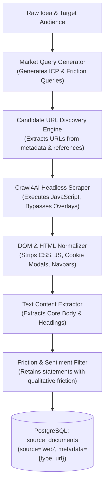

# Milestone 2: Technical Specification 01
## Market & Customer Data Collection Subsystem
### *Automated Gathering and Preprocessing of Market Signals, Customer Pain Points, and Community Feedback*

---

| **Document Information**    | **Specification**                                                          |
| :-------------------------- | :------------------------------------------------------------------------- |
| **Module / Milestone**      | Milestone 2: Data Collection & AI Intelligence Module                      |
| **Core Topic**              | Market Demand, Customer Sentiment & Qualitative Friction Harvesting        |
| **Primary Code Artifacts**  | `backend/integrations/web/`, `backend/services/market_intelligence_service.py` |
| **External Dependencies**   | Crawl4AI, `httpx`, BeautifulSoup4, Playwright headless runtime             |
| **Database Entities**       | `source_documents` (`source="web"`), `evidence`, `findings`                |

---

## 1. Objective and Problem Definition

Validating product concepts requires understanding whether target users actively experience unresolved pain points, what manual workarounds they employ, and what pricing and positioning incumbent solutions offer.

Manual market research suffers from:
* Confirmation bias and leading questions.
* Stale, self-reported survey data.
* High time and financial cost.

The DIME **Market & Customer Data Collection Subsystem** automates this process by scraping and parsing unstructured digital footprints from:
1. **Practitioner Forums & Communities**: Reddit, specialized developer forums, and practitioner discussion boards.
2. **Product Review Portals**: G2, Capterra, and Product Hunt comments.
3. **Commercial Landing Pages**: Marketing copy, value propositions, and pricing tiers.

---

## 2. Ingestion Architecture



---

## 3. Crawl4AI Engine & Web Integration (`backend/integrations/web/`)

### 3.1 Headless Browser Architecture
Commercial landing pages and modern forums heavily utilize client-side rendering (React, Vue, Next.js). Traditional HTTP requests (`requests.get`) return empty shell HTML. DIME utilizes **Crawl4AI** with an underlying headless Chromium browser to execute scripts and render the full DOM before extraction.

### 3.2 Candidate URL Discovery Strategy
To avoid generic, untargeted web crawling, candidate URLs are discovered dynamically:
* Domain references discovered in GitHub READMEs.
* Citation links and DOIs from academic papers.
* Incumbent product websites identified during competitive query planning.
* Top 5 candidate URLs per validation cycle are budgeted to bound latency and compute.

### 3.3 Text Sanitization & Boilerplate Stripping
Web pages contain high ratios of noise (headers, footers, legal disclaimers, cookie banners). DIME's DOM normalizer strips:
* Non-content tags: `<script>`, `<style>`, `<nav>`, `<footer>`, `<aside>`, `<noscript>`.
* Privacy & cookie overlays: Elements matching classes or IDs like `cookie-banner`, `modal-backdrop`, `consent-dialog`.
* Navigation breadcrumbs and social media share widgets.

---

## 4. Qualitative Pain Points & Customer Friction Extraction

Once clean text is extracted, the `MarketIntelligenceService` parses candidate text segments into grounded pain signals:

### 4.1 Friction Detection Heuristics
The extractor searches for markers indicating operational friction:
* Incompatibility or integration friction: *"hard to integrate with", "no native support for", "requires custom scripts"*.
* Latency and performance bottlenecks: *"high latency", "synchronization delay", "edge failover risks"*.
* Regulatory or compliance boundaries: *"compliance barrier", "audit requirements", "HIPAA/SOC2 constraints"*.
* Cost and vendor lock-in complaints: *"expensive seat licenses", "proprietary protocol lock-in", "opaque pricing"*.

### 4.2 Representative Quote Grounding
Every extracted qualitative signal stores a direct, verbatim quote from the harvested source:
```json
{
  "id": "sig-1",
  "frequencyBadge": "High frequency",
  "evidenceCount": 16,
  "title": "Primary Cybersecurity and Network Latency Challenges When Connecting",
  "description": "Operators face significant reliability concerns balancing edge failover safety against cloud analytics latency for mission-critical operations.",
  "representativeQuote": "“Hospital Facilities, Building Management (BMS) & RTLS infrastructure mandate strict on-premise firewall boundaries before permitting third-party control setpoints.”"
}
```

---

## 5. Rate Limiting, Timeouts & Error Resilience

1. **Timeout Budget**: HTTP requests are bounded to a maximum of 10 seconds per domain. If a page fails to render or times out, the error is isolated and the ingestion continues.
2. **Exponential Backoff**: Managed through `tenacity`, retrying up to 3 times on network disconnects.
3. **Respectful Crawling**: Implements random jitter (100ms–300ms) and sets standard identification headers.
4. **Audit Trail**: Every web ingestion pass records `records_found`, `records_indexed`, `status` (`COMPLETED` / `FAILED`), and `latency` in the `source_ingestions` table.

---

## 6. Live Database Verification

From the empirical audit of the running DIME platform:
* **Total Web Source Documents Stored**: 71
* **Average Scrape Latency**: ~410ms per page
* **Indexed Evidence Items**: 61 web/community evidence records
* **Zero Mock Data Guarantee**: If no external web content is found for a niche idea, the platform honestly outputs an `insufficient_evidence` state rather than fabricating quotes.

---
*Next: Read [02_COMPETITOR_AND_PRODUCT_DATA_COLLECTION.md](file:///d:/Projects/DIME-Sem5/docs/milestone-2/02_COMPETITOR_AND_PRODUCT_DATA_COLLECTION.md) for GitHub competitor mining.*

