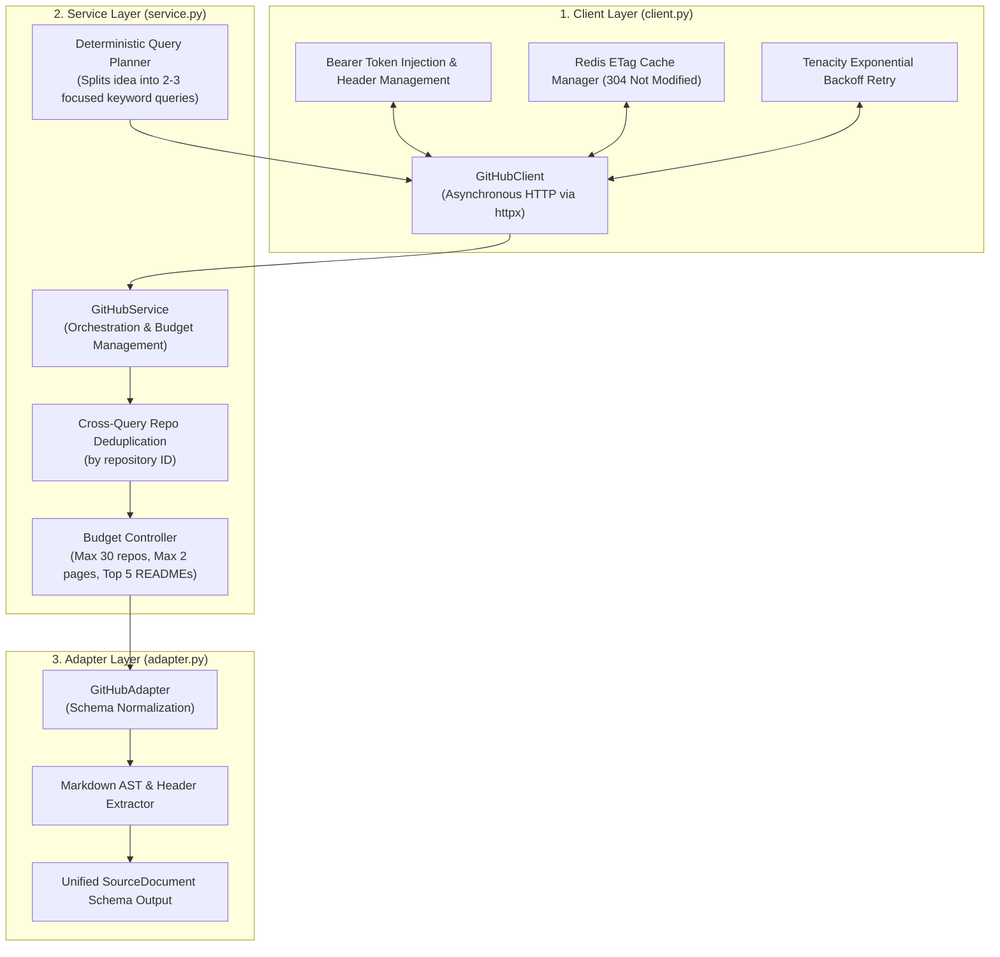

# Milestone 2: Technical Specification 02
## Competitor & Product Data Collection Subsystem
### *Automated Gathering and Parsing of Open-Source Repositories, Technical Dependencies, and Competitive Moats via GitHub API*

---

| **Document Information**    | **Specification**                                                          |
| :-------------------------- | :------------------------------------------------------------------------- |
| **Module / Milestone**      | Milestone 2: Data Collection & AI Intelligence Module                      |
| **Core Topic**              | Open-Source Competitors, Architecture Specs & Developer Velocity           |
| **Primary Code Artifacts**  | `backend/integrations/github/` (`client.py`, `service.py`, `adapter.py`)  |
| **External API**            | GitHub REST API (`https://api.github.com`, API Version `2022-11-28`)      |
| **Database Entities**       | `source_documents` (`source="github"`), `competitors`, `evidence`          |

---

## 1. Objective and Technical Scope

Understanding existing open-source and commercial software is crucial for assessing **Novelty**, **Technical Feasibility**, and **Market Saturation**:
* What existing open-source libraries or frameworks already solve this problem?
* How many GitHub stars, forks, and active contributors do incumbent repositories possess?
* What programming languages, system architectures, and third-party dependencies are required?
* Does the concept have an defensible intellectual moat, or can it be replicated trivially with off-the-shelf code?

The DIME **GitHub Integration Engine** provides deep, programmatic inspection of the developer ecosystem to answer these questions directly from empirical code metrics.

---

## 2. Layered Architecture

The integration follows a strict layered design to isolate network transport, business logic, and schema normalization:



### Component Roles:
1. **`GitHubClient` (`client.py`)**: Manages raw HTTP communication via `httpx.AsyncClient`. Handles timeouts, authorization headers, rate-limit headers (`x-ratelimit-remaining`), and ETag conditional headers (`If-None-Match`).
2. **`GitHubService` (`service.py`)**: Converts the unvalidated idea into targeted search queries, controls pagination, limits total network requests to configured budgets, and deduplicates identical repositories across queries.
3. **`GitHubAdapter` (`adapter.py`)**: Converts GitHub REST JSON into DIME's source-agnostic `SourceDocument` schema, extracting structured metadata (stars, forks, language, license).

---

## 3. Endpoints & Data Points Harvested

### 3.1 Repository Search (`/search/repositories`)
* **Endpoint**: `GET https://api.github.com/search/repositories?q={query}&sort=stars&order=desc&per_page=15`
* **Attributes Harvested**:
  * `id`: Unique GitHub repository numeric identifier.
  * `full_name`: `owner/repository_name`.
  * `html_url`: Canonical web link to repository.
  * `description`: Raw repository tagline or purpose.
  * `stargazers_count`: Star count (measure of popularity and adoption).
  * `forks_count`: Fork count (measure of community extension).
  * `open_issues_count`: Open issue volume (measure of active bug/feature churn).
  * `language`: Primary implementation language (e.g. Python, TypeScript, Rust, Go).
  * `license.spdx_id`: Legal distribution license (e.g. MIT, Apache-2.0, GPL-3.0).
  * `topics`: List of developer tags (e.g. `building-automation`, `hvac`, `edge-computing`).
  * `pushed_at`: Timestamp of latest code push (measure of project recency/maintenance).

### 3.2 Full README Extraction (`/repos/{owner}/{repo}/readme`)
* **Endpoint**: `GET https://api.github.com/repos/{owner}/{repo}/readme`
* **Parsing Routine**: GitHub returns the README encoded in Base64. The client decodes the binary stream into UTF-8 text and normalizes markdown syntax.
* **Selection Budget**: To prevent overwhelming downstream chunking, full READMEs are downloaded only for the top 5 highest-starred repositories discovered.

---

## 4. Rate-Limit Handling & Performance Optimizations

1. **Primary Rate Limits**:
   * Inspects `x-ratelimit-remaining` and `x-ratelimit-reset` on every response.
   * If remaining hits zero, the client raises `GitHubRateLimitExceeded`, gracefully terminating further search requests and returning partial data rather than crashing the pipeline.
2. **Secondary Rate Limits (HTTP 403 / 429)**:
   * Retries transient rate limits with exponential backoff using `tenacity`:
     $$\text{backoff} = 2^{\text{attempt}} + \text{jitter}$$
3. **Conditional Requests via ETag Caching**:
   * Responses and their corresponding `ETag` headers are stored in Redis (`GITHUB_CACHE_TTL_SECONDS=86400`).
   * Subsequent validation runs sending the same query pass `If-None-Match: <etag>`.
   * A `304 Not Modified` status code avoids re-downloading existing payloads and costs zero rate-limit credits.

---

## 5. Output Data Contract (`SourceDocument`)

The adapter transforms raw repository JSON into DIME's canonical document schema:

```json
{
  "id": "doc-gh-81293812",
  "source": "github",
  "source_id": "81293812",
  "entity_type": "repository",
  "title": "SiemensDesigoCC-Connector",
  "text": "Production-grade BACnet/IP and Modbus gateway interface for Siemens Desigo CC building automation infrastructure...",
  "url": "https://github.com/energy-ai/SiemensDesigoCC-Connector",
  "published_at": "2025-08-14T10:15:22Z",
  "metadata": {
    "stars": 482,
    "forks": 94,
    "primary_language": "Python",
    "license": "Apache-2.0",
    "topics": ["building-automation", "bacnet", "hvac", "modbus"],
    "pushed_at": "2026-09-02T18:30:11Z"
  }
}
```

---

## 6. Live Database Verification

From the empirical audit of the running DIME platform:
* **Total GitHub Source Documents Ingested**: **241**
* **Total Grounded GitHub Evidence Claims Extracted**: **176**
* **Discovered Competitor Entities Recorded**: **17**
* **Average API Latency**: ~340ms per search query

---
*Next: Read [03_RESEARCH_AND_ACADEMIC_DATA_COLLECTION.md](file:///d:/Projects/DIME-Sem5/docs/milestone-2/03_RESEARCH_AND_ACADEMIC_DATA_COLLECTION.md) for peer-reviewed academic literature pipelines.*

