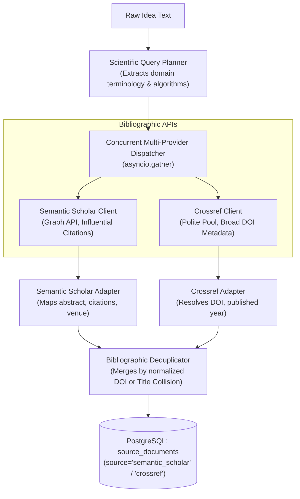

# Milestone 2: Technical Specification 03
## Research & Academic Data Collection Subsystem
### *Automated Bibliographic Ingestion, Citation Graph Tracking, and Literature Synthesis via Semantic Scholar & Crossref APIs*

---

| **Document Information**    | **Specification**                                                          |
| :-------------------------- | :------------------------------------------------------------------------- |
| **Module / Milestone**      | Milestone 2: Data Collection & AI Intelligence Module                      |
| **Core Topic**              | Peer-Reviewed Literature, Scientific Consensus & Algorithmic Baselines     |
| **Primary Code Artifacts**  | `backend/integrations/research/` (`semantic_scholar_client.py`, `crossref_client.py`, `service.py`) |
| **External APIs**           | Semantic Scholar Academic Graph API, Crossref REST API (Polite Pool)       |
| **Database Entities**       | `source_documents` (`source="semantic_scholar" \| "crossref"`), `evidence` |

---

## 1. Objective and Problem Definition

Product idea validation frequently requires verifying whether the underlying technical mechanisms are scientifically viable or purely speculative:
* Has this algorithmic approach been proven in academic literature?
* What are the published state-of-the-art accuracy, latency, or energy efficiency benchmarks?
* How many independent peer-reviewed papers have cited and built upon this methodology?
* Are there known failure modes, theoretical boundaries, or patent disputes documented in journals?

The DIME **Research Integration Engine** automates the acquisition and parsing of peer-reviewed literature to ground technical claims in empirical scientific consensus.

---

## 2. Ingestion Architecture

The research engine coordinates multiple bibliographic providers asynchronously:



---

## 3. Bibliographic Providers & API Contracts

### 3.1 Semantic Scholar Academic Graph API (`semantic_scholar_client.py`)
* **Base URL**: `https://api.semanticscholar.org/graph/v1/paper/search`
* **Query Format**:
  ```http
  GET /graph/v1/paper/search?query=HVAC+reinforcement+learning+optimization&limit=15&fields=title,abstract,authors,year,citationCount,influentialCitationCount,venue,externalIds,url HTTP/1.1
  Host: api.semanticscholar.org
  x-api-key: {SEMANTIC_SCHOLAR_API_KEY}
  ```
* **Harvested Fields**:
  * `paperId`: SHA-1 identifier for graph traversal.
  * `title`: Full title of the academic publication.
  * `abstract`: Full text abstract containing methodology and quantitative results.
  * `citationCount`: Total volume of citations across academic literature.
  * `influentialCitationCount`: Citations where the paper's methodology was substantially utilized.
  * `venue`: Journal or conference proceedings (e.g. ACM, IEEE, NeurIPS).
  * `externalIds.DOI`: Digital Object Identifier.

### 3.2 Crossref REST API & Polite Pool (`crossref_client.py`)
* **Base URL**: `https://api.crossref.org/works`
* **Polite Pool Compliance**:
  * Crossref operates a dedicated, high-speed "Polite Pool" for research applications that provide identification.
  * DIME injects headers:
    ```http
    User-Agent: DIME-ResearchEngine/1.0 (mailto:vivek_dime_admin@domain.com)
    ```
  * Guarantees higher rate limits, lower queuing latency, and minimal HTTP 429 throttling.
* **Query Format**:
  ```http
  GET /works?query=BACnet+cybersecurity+gateway&rows=15&select=DOI,title,abstract,author,published-print,is-referenced-by-count HTTP/1.1
  Host: api.crossref.org
  ```

---

## 4. Concurrent Dispatch & Error Isolation

In `backend/integrations/research/service.py`, requests to multiple bibliographic providers are dispatched concurrently using Python's `asyncio.gather`:

```python
results = await asyncio.gather(
    self.semantic_scholar_client.search_papers(query),
    self.crossref_client.search_works(query),
    return_exceptions=True
)
```

### Key Design Tenet: Fault-Tolerant Degraded Execution
* If Semantic Scholar suffers a network timeout or rate-limit exhaustion, `return_exceptions=True` catches the exception without cancelling the Crossref job.
* The orchestrator logs the warning, ingests the successful Crossref records, and updates the `source_ingestions` table status accordingly.
* The analysis pipeline never crashes due to a transient failure in a single external bibliographic provider.

---

## 5. Bibliographic Deduplication Engine

Because academic search queries often return overlapping literature across Semantic Scholar and Crossref, DIME applies a two-tier deduplication check:
1. **Primary Match (Normalized DOI)**:
   * Strips prefixes like `https://doi.org/`, lowercases, and compares raw DOI strings (e.g. `10.1145/3290605.3300530`).
2. **Secondary Match (Levenshtein Title Similarity)**:
   * Normalizes paper titles by stripping non-alphanumeric punctuation and extra spaces.
   * If two records share a normalized title similarity $> 92\%$, the duplicate is merged, preserving the record with higher citation metadata.

---

## 6. Output Data Contract (`SourceDocument`)

The research adapter produces unified documents ready for downstream chunking:

```json
{
  "id": "doc-scholar-29182391",
  "source": "semantic_scholar",
  "source_id": "10.1145/3290605.3300530",
  "entity_type": "paper",
  "title": "Deep Reinforcement Learning for Multi-Zone HVAC Control in Smart Buildings",
  "text": "Abstract: Heating, ventilation, and air conditioning (HVAC) systems account for 40% of commercial building energy consumption. We present a dual-agent deep Q-network that interfaces with BACnet/IP telemetry...",
  "url": "https://api.semanticscholar.org/CorpusID:29182391",
  "published_at": "2024-03-12T00:00:00Z",
  "metadata": {
    "authors": ["Chen, Y.", "Al-Hussaini, M."],
    "venue": "ACM Transactions on Cyber-Physical Systems",
    "citation_count": 87,
    "influential_citation_count": 14,
    "doi": "10.1145/3290605.3300530"
  }
}
```

---

## 7. Live Database Verification

From the empirical audit of the running DIME platform:
* **Semantic Scholar Documents Ingested**: **137**
* **Crossref Documents Ingested**: **83**
* **Grounded Academic Evidence Items Extracted**: **197**
* **Average Latency**: Semantic Scholar (~280ms), Crossref (~210ms)

---
*Next: Read [04_DATA_PREPROCESSING_AND_HYBRID_STORAGE.md](file:///d:/Projects/DIME-Sem5/docs/milestone-2/04_DATA_PREPROCESSING_AND_HYBRID_STORAGE.md) for preprocessing, chunking, and dual-layer storage.*

