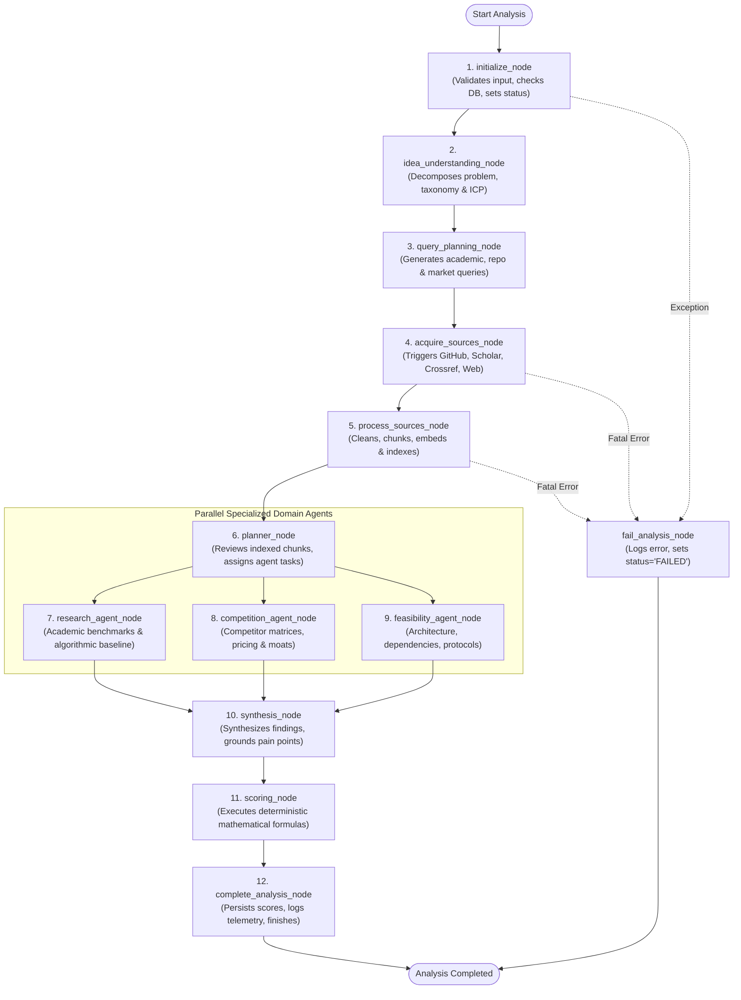
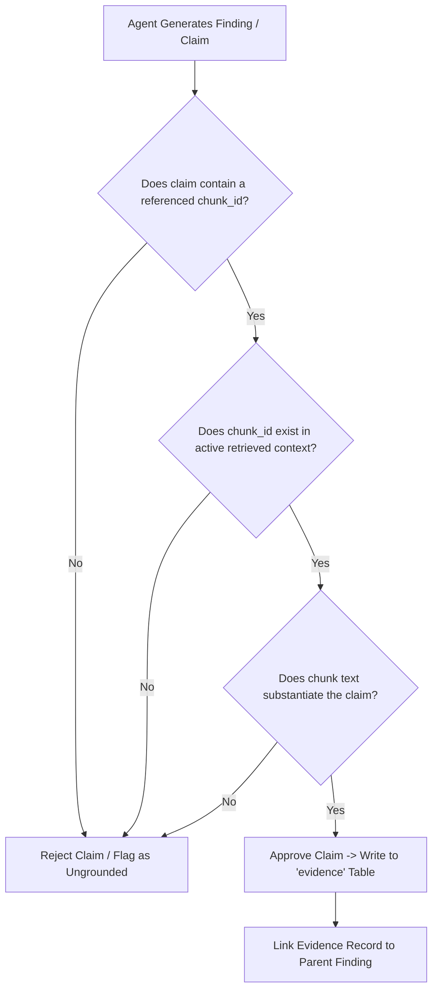

# Milestone 2: Technical Specification 05
## AI Intelligence & Multi-Agent Orchestration Subsystem
### *Autonomous Multi-Agent Workflow, LangGraph StateGraph Architecture, and Programmatic Citation Grounding*

---

| **Document Information**    | **Specification**                                                          |
| :-------------------------- | :------------------------------------------------------------------------- |
| **Module / Milestone**      | Milestone 2: Data Collection & AI Intelligence Module                      |
| **Core Topic**              | Multi-Agent Orchestration, Domain Reasoners & Anti-Hallucination Grounding  |
| **Primary Code Artifacts**  | `backend/workflow/graph.py`, `backend/workflow/nodes.py`, `backend/agents/` |
| **Frameworks Utilized**     | LangGraph, LangChain Core, Pydantic V2, OpenAI / Anthropic LLM runtimes    |
| **Database Entities**       | `evidence`, `findings`, `agent_activities`                                 |

---

## 1. Objective and Problem Definition

Validating a complex product concept involves analyzing fundamentally different domains:
* Scientific feasibility requires analyzing mathematical methodologies and benchmark papers.
* Competitive analysis requires comparing software feature sets, licensing, and pricing.
* Market demand requires analyzing customer friction and willingness to pay.

A single monolithic LLM prompt fails at this task because:
1. It conflates distinct domains, leading to generic, superficial summaries.
2. It hallucinates statistics and non-existent citations to satisfy user prompts.
3. It cannot manage token limits when reasoning over hundreds of pages of external evidence.

The DIME **AI Intelligence Subsystem** addresses this by deploying specialized, autonomous agents coordinated by a state-machine graph built on **LangGraph**.

---

## 2. LangGraph 12-Node StateGraph Architecture

The workflow is modeled as a directed, cyclic execution graph (`backend/workflow/graph.py`):



---

## 3. The `AgentState` Shared Memory Schema

State is passed immutably across graph nodes using a typed Pydantic dictionary (`AgentState`):

```python
class AgentState(TypedDict):
    analysis_id: str
    idea_id: str
    title: str
    description: str
    target_audience: str
    domain: str
    research_profile: dict[str, Any]
    planned_queries: list[dict[str, str]]
    acquired_documents: list[str]
    indexed_chunks: list[str]
    evidence_items: list[dict[str, Any]]
    findings: list[dict[str, Any]]
    scores: dict[str, float]
    errors: list[str]
    status: str
```

---

## 4. Specialized Agent Responsibilities

### 4.1 Idea Understanding Agent
* **Role**: Transforms ambiguous, casual user pitches into a structured `ResearchProfile`.
* **Output Schema**:
  * `core_problem`: The specific underlying friction being addressed.
  * `target_icp`: Precise target user persona (e.g. *Hospital Facilities Director*).
  * `functional_requirements`: Expected technical capabilities (e.g. *BACnet IP telemetry, edge failover*).
  * `domain_taxonomy`: Standardized industry category.

### 4.2 Query Planning Agent
* **Role**: Generates orthogonal search queries tailored for distinct search engines:
  * *Academic Queries*: Formatted with academic keywords (e.g. *"deep Q-network HVAC energy simulation"*).
  * *Repository Queries*: Formatted for GitHub (e.g. *"BACnet python gateway open-source"*).
  * *Commercial Queries*: Formatted for SaaS tools (e.g. *"hospital BMS edge control software pricing"*).

### 4.3 Research Intelligence Agent (`backend/agents/research.py`)
* **Role**: Evaluates academic chunks retrieved from Qdrant.
* **Execution**: Extracts published state-of-the-art benchmarks, scientific consensus, and open algorithmic questions.
* **Citation Grounding**: Requires every benchmark statement to cite the exact paper DOI and chunk ID.

### 4.4 Competitive Intelligence Agent (`backend/agents/competition.py`)
* **Role**: Analyzes discovered software repositories and commercial websites.
* **Outputs**:
  * Classification into Direct, Indirect, and Incumbent solutions.
  * Identification of proprietary moats (hardware tie-ins, proprietary protocols, patents).
  * Feature parity matrices and open-source alternatives.

### 4.5 Market & Customer Pain Synthesis Agent
* **Role**: Scans community forum and review chunks for recurring friction.
* **Outputs**:
  * Qualitative pain signals ranked by citation volume.
  * Sentiment breakdowns (Positive, Neutral, Negative, Urgent).
  * Extraction of verbatim practitioner quotes.

---

## 5. Programmatic Citation Grounding & Hallucination Mitigation

To guarantee zero hallucinated facts in DIME:



### Strict Grounding Rules Enforced:
1. **Chunk Provenance**: Every `Evidence` record in PostgreSQL maintains a mandatory foreign key or reference to `chunk_id` and `document_id`.
2. **Deterministic Fallbacks for Gaps**: When evidence is missing for a specific domain question, DIME strictly forbids the LLM from fabricating an answer. Instead, the finding is categorized as a **Research Gap** (e.g. *"Lack of verified public benchmarks regarding edge inference latency"*).
3. **Audit Logging**: Every prompt, completion, token count, model temperature, and execution latency is recorded in the `agent_activities` table (773 records logged in live DB).

---

## 6. Live Database Verification

From the empirical audit of the running DIME platform:
* **Total Executed Analyses in StateGraph**: **49**
* **Total Grounded Evidence Records Written**: **379**
* **Total Synthesized Findings Categorized**: **281**
* **Total Agent Activities Logged in DB**: **773**

---
*Next: Read [06_DETERMINISTIC_SCORING_ENGINE.md](file:///d:/Projects/DIME-Sem5/docs/milestone-2/06_DETERMINISTIC_SCORING_ENGINE.md) for mathematical metric derivations.*

