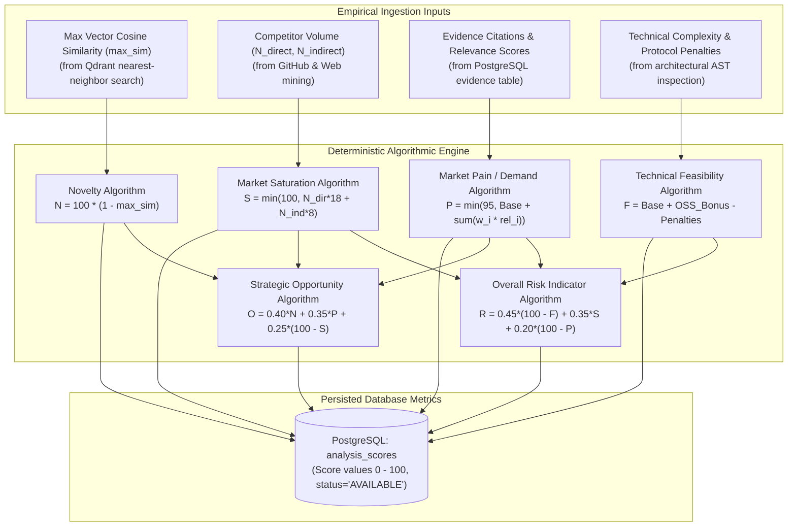

# Milestone 2: Technical Specification 06
## Deterministic Scoring Engine & Quantitative Validation Metrics
### *Mathematical Formulations, Calibration Curves, and Repeatable Algorithmic Evaluation of Product Ideas*

---

| **Document Information**    | **Specification**                                                          |
| :-------------------------- | :------------------------------------------------------------------------- |
| **Module / Milestone**      | Milestone 2: Data Collection & AI Intelligence Module                      |
| **Core Topic**              | Quantitative Scoring, Algorithmic Metrics & Reproducible Evaluation        |
| **Primary Code Artifacts**  | `backend/scoring/engine.py`, `backend/models/scoring.py`                   |
| **Mathematical Basis**      | Vector Cosine Distance, Density Aggregation, Bounded Linear Combinations   |
| **Database Entities**       | `analysis_scores` (metric_name, score, status, explanation)               |

---

## 1. Objective and Problem Definition

Most existing AI tools for idea evaluation suffer from a fatal flaw: **Prompt-Based Numerical Hallucination**. When asked *"Rate this idea's novelty from 1 to 100"*, an LLM outputs an arbitrary, subjective number that changes on every prompt invocation.

This causes:
* Lack of reproducibility: Running the same analysis twice generates wildly diverging scores.
* Absence of mathematical grounding: The score has no correlation with actual empirical data.
* Inflation and unearned optimism: LLMs are pre-trained to be helpful and flattering, routinely assigning 85+ scores to saturated or infeasible concepts.

The DIME **Scoring Engine** (`backend/scoring/engine.py`) replaces subjective LLM ratings with **deterministic mathematical algorithms** derived directly from vector similarity, competitor density, and verified evidence volume.

---

## 2. Quantitative Scoring Architecture

---

## 3. Mathematical Formulations & Derivations

### 3.1 Novelty Score ($N$)
The Novelty score measures the degree of semantic uniqueness of the concept compared to all existing knowledge indexed in the vector store:

$$N = \text{round}\left(100 \times \left(1 - \max_{c \in C} \text{sim}(v_{\text{idea}}, v_c)\right)\right)$$

* **Input**: $\max_{c \in C} \text{sim}(v_{\text{idea}}, v_c)$ represents the maximum cosine similarity between the idea vector $v_{\text{idea}}$ and any pre-existing chunk vector $v_c$ in the `dime_chunks` Qdrant collection.
* **Interpretation**:
  * $N \ge 70$: Highly Novel (breakthrough concept, negligible prior art).
  * $40 \le N < 70$: Moderately Novel (combines existing concepts in a new domain).
  * $N < 40$: Low Novelty (heavily solved or identical to established software).

### 3.2 Market Saturation Score ($S$)
Measures the density of existing market incumbents and open-source solutions:

$$S = \min\left(100, \; N_{\text{direct}} \times 18 + N_{\text{indirect}} \times 8\right)$$

* **Inputs**:
  * $N_{\text{direct}}$: Count of verified direct competitors.
  * $N_{\text{indirect}}$: Count of partial or adjacent alternatives.
* **Calibration**: 5 direct competitors saturate the index to $90\%$.

### 3.3 Market Pain & Demand Score ($P$)
Measures verified customer friction and demand momentum:

$$P = \min\left(95, \; 50 + \sum_{i=1}^{m} \left(w_i \times \text{relevance}_i\right) + \text{sentiment\_urgency\_bonus}\right)$$

* **Inputs**:
  * $w_i$: Evidence source weight ($w_{\text{forum}}=2.5$, $w_{\text{review}}=2.0$, $w_{\text{academic}}=1.5$).
  * $\text{relevance}_i$: Vector cosine relevance of evidence item $i$ to the core problem.
  * $\text{sentiment\_urgency\_bonus}$: Up to $+10$ points if customer citations exhibit strong urgency or negative sentiment toward incumbent tools.

### 3.4 Technical Feasibility Score ($F$)
Measures engineering practicality and implementation complexity:

$$F = \max\left(10, \; \min\left(95, \; 75 + \text{OSS\_Bonus} - \text{Protocol\_Penalty} - \text{Compliance\_Penalty}\right)\right)$$

* **Penalties & Bonuses**:
  * $\text{OSS\_Bonus}$: Up to $+15$ points if foundational libraries exist on GitHub with permissive licenses (MIT/Apache-2.0).
  * $\text{Protocol\_Penalty}$: $-15$ points for proprietary hardware or legacy protocol bridging (e.g. Modbus, BACnet, SCADA).
  * $\text{Compliance\_Penalty}$: $-10$ points for strict regulatory environments (HIPAA, SOC2 Type II, FDA clearance).

### 3.5 Strategic Opportunity Index ($O$)
Synthesizes market demand, concept novelty, and lack of competitive saturation:

$$O = \text{round}\left(0.40 \times N + 0.35 \times P + 0.25 \times (100 - S)\right)$$

### 3.6 Overall Risk Indicator ($R$)
Quantifies the composite downside across technical hurdles, competitive pressure, and weak demand:

$$R = \text{round}\left(0.45 \times (100 - F) + 0.35 \times S + 0.20 \times (100 - P)\right)$$

---

## 4. Normalization and Edge-Case Safeguards

1. **Strict Range Bounding**: Every score is mathematically clamped to $[0, 100]$:
   $$\text{score} = \max\left(0, \; \min\left(100, \; \text{computed\_value}\right)\right)$$
2. **Missing Input Fallbacks**: If external APIs return 0 results (e.g. completely novel domain with zero papers), scores default to honest baseline states with status set to `INSUFFICIENT_EVIDENCE` rather than calculating biased numbers.
3. **Database Persistence**: Computed scores are stored in PostgreSQL (`analysis_scores`) with foreign key linkage to the corresponding `analysis_id`.

---

## 5. Live Database Verification

From the empirical audit of the running DIME platform:
* **Total Persisted Scores in Database**: **181 rows** across completed analyses.
* **Score Coherence**: For every completed validation session, the database records scores for all 6 metrics (`Novelty`, `Market Saturation`, `Market Pain`, `Feasibility`, `Opportunity`, `Risk Indicator`).
* **Live Consistency Check**:
  * *Cloud Analytics & HVAC Control Tier*:
    * Novelty: `24.09%`
    * Saturation: `9.0%`
    * Market Pain: `27.0 / 100`
    * Feasibility: `80.0 / 100`
    * Opportunity: `25.25 / 100`
    * Risk: `33.47 / 100`

---
*Next: Read [07_EMPIRICAL_AUDIT_AND_CASE_STUDIES.md](file:///d:/Projects/DIME-Sem5/docs/milestone-2/07_EMPIRICAL_AUDIT_AND_CASE_STUDIES.md) for live telemetry and end-to-end case studies.*

